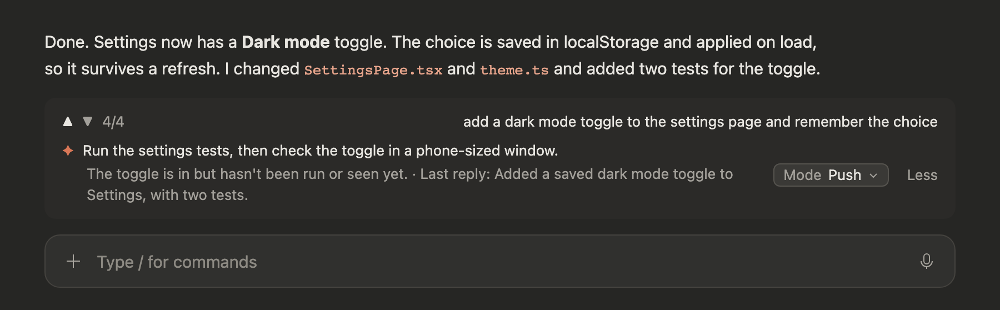
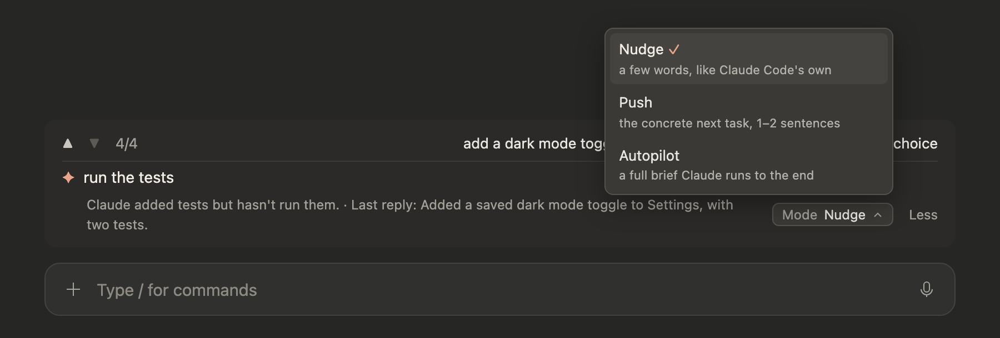
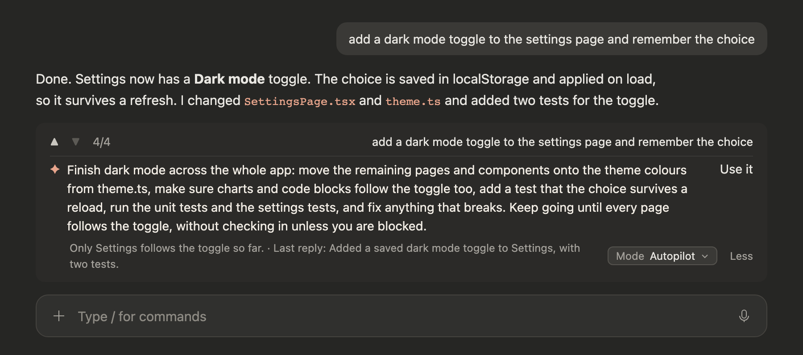
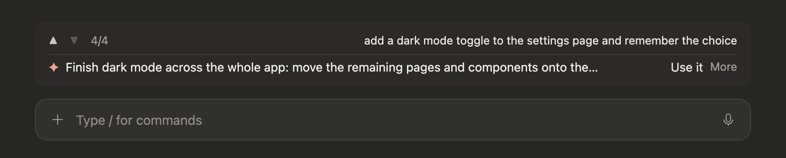
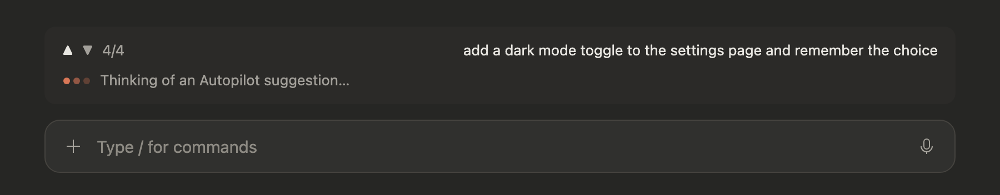

# steady-suggest

A Claude Code mod that suggests your next prompt after every reply, tells you why, and keeps your own prompts one click away.

It adds a strip above the prompt box:



<sub>Screens are design mock-ups of the desktop app's Code tab, drawn with a sample conversation. The real strip uses the app's own fonts and colours. Their sources are in <code>docs/mockups</code>; <code>shoot.mjs</code> there renders them.</sub>

- **History row** (top): your latest prompt, with ▲ ▼ to step back through earlier ones. While your newest prompt is still on screen the row stays hidden (`/pin-prompt smart` turns that off). `/prompts` lists them all in a pane; click one to copy it.
- **Suggestion** (under it, desktop app): what you would likely type next. Click it to put it in the box; a suggestion over 80 characters wraps, with a **Use it** button instead. Nothing is sent until you press Enter. The line hides while Claude is working and clears when you send your next message.
- **Why and recap**: a one-sentence reason and a few words on Claude's last reply, on the dim line under the suggestion.
- **Mode**: how far the suggestion goes, and which model writes it.
  - **Nudge** (the default, Sonnet 5.5): 2–12 words, like Claude Code's own suggestion.
  - **Push** (Opus 5.5): one or two sentences (10–40 words) naming the concrete next task and the files or checks it involves.
  - **Autopilot** (Fable 5.2): a full hand-off brief (goal, steps, what done looks like, keep going until done unless blocked) so Claude can carry a feature or an investigation through. Fable is told to leave out deploying, pushing, merging, migrations, seed scripts, deleting data and posting comments or messages unless you already asked for them in the chat, so read a brief before you send it.
- **Less / More**: fold the suggestion to one line, or show it in full. Your Mode and view are remembered across chats.

### Modes

Pick a mode from the **Mode** dropdown at the end of the dim line. The suggestion for the current reply is written again at that length right away.



Autopilot writes a brief Claude can run to the end on its own. The strip shows up to 600 characters of it; **Use it** puts the whole brief in the box.



### Less and More

**Less** folds the suggestion to one line and hides the reason line and the Mode dropdown. A long suggestion is cut at 90 characters, and **Use it** still puts the whole text in the box; a short one stays clickable. **More** brings the full view back.



### While it thinks

While a suggestion is being written, the line under the history row shows pulsing dots and "Thinking of a suggestion…" (in Push or Autopilot, "Thinking of a Push suggestion…" or "Thinking of an Autopilot suggestion…"). It stays up at least two seconds.



## Install

At the prompt of a terminal session:

```
/plugin install steady-suggest --marketplace RolandOne/steady-suggest
```

Answer `y` to add the marketplace, then pick a scope (user scope loads it in every session).

From a shell:

```
claude plugin install steady-suggest --marketplace RolandOne/steady-suggest
```

In the desktop app, where `/plugin` does not run: click **+** next to the prompt box, then **Plugins**, **Add marketplace** with `RolandOne/steady-suggest`, then **Add plugin**. A mod installed from a terminal at the user scope also loads in the desktop app's Code tab. Restart the app after installing.

## Commands

| Command | What it does |
| --- | --- |
| `/suggest` | Shows what the suggestion did this session, the current Mode and its model, and the view |
| `/suggest nudge` · `push` · `autopilot` | Sets the Mode (and so the model) and rewrites the current suggestion |
| `/suggest compact` · `full` | Folds the suggestion to one line, or shows it in full |
| `/prompts` | Lists every prompt of the session in a pane |
| `/pin-prompt` | Jumps the history row back to your newest prompt; `/pin-prompt smart` toggles hiding it while your newest prompt is on screen |

## How it works

1. When Claude's reply ends (or you open a chat that has no suggestion yet), the mod gathers your last few prompts and the end of the reply.
2. It asks the Mode's model (Sonnet 5.5, Opus 5.5 or Fable 5.2), in a side call outside your chat, for three lines: the suggestion, why, and a recap. The Mode also sets how long the suggestion may be and how much of the session the model reads.
3. It checks the suggestion the way Claude Code checks its own (length, no "Let me…", no "looks good") and asks once more if it fails, saying what was wrong. If the second answer fails too, the line stays empty for that reply.
4. It shows the result in the strip and, where the app allows, as the dim suggestion inside the box.

**When the line stays empty on purpose:** the model is told to write nothing when Claude got your request wrong (you will want to put that right in your own words), when Claude is waiting on something only you can do and nothing else is left to suggest, or when the message itself would do harm, such as one that would have to contain a password. That silence stands for the reply; the log line starts with `silent` and gives the reason. A suggestion never says you did something the chat does not show ("I ran it", "signed in"), because Claude would take it as fact.

**Cost:** every reply makes one call to the Mode's model on your own account, a second when the first suggestion fails the checks, and another each time you change the Mode. Autopilot calls are the largest, and Fable is the priciest of the three models.

**Models:** each mode names a fixed model version. If your account can't use one, that mode's line stays empty and the log names the model and the error; pick another mode.

**Desktop and terminal:** the suggestion strip draws in the desktop app's Code tab. In a terminal the mod fills in Claude Code's own suggestion on the turns where it skips one, and the history row adds a **Go to** button that scrolls the chat to that prompt (the desktop app does not let a mod scroll the chat).

A log of what the mod did is kept in `steady-suggest.log` inside the plugin folder.

## License

MIT
